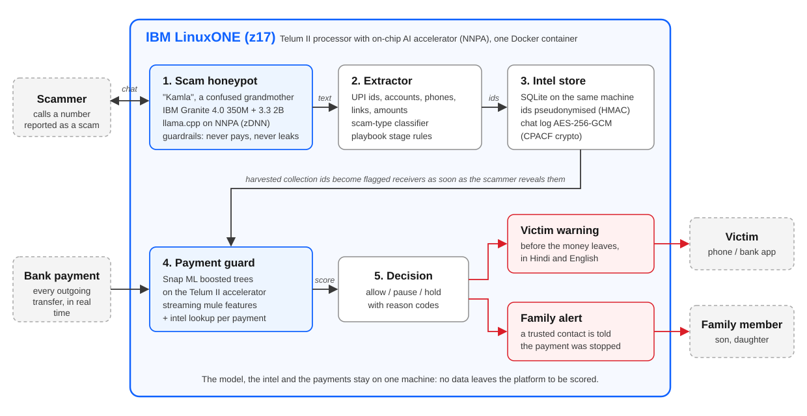

# Forest

Team Forest, IBM Z Datathon 2026 (SSF2026).

Scammers reveal the UPI ids and bank accounts they collect money on to anyone who plays along, so Forest plays along. A Granite-powered honeypot persona keeps the scammer talking, pulls out every collection id they give, and hands those ids to a payment guard on the same IBM LinuxONE machine. When a real victim later tries to pay one of those ids, the payment is held before the money leaves, the victim sees a warning in Hindi and English, and a family member is told. The guard also scores every other payment with a Snap ML model for mule patterns, so receivers the honeypot never met are still caught.

Headline results: the guard holds 50% of laundering payments while stopping only 0.1% of all payments, scores a payment in 0.17 ms at p99 on the z17 (0.62 ms inside the running service), and 15 of 15 simulated scam chats gave up their collection ids.



## The problem

India lost Rs 22,845.7 crore to cyber fraud in 2024 across 22.6 lakh reported incidents, up 206% on 2023 (Ministry of Home Affairs, reply in the Lok Sabha). "Digital arrest" scams alone, where a caller posing as police or CBI tells the victim they are under investigation and must pay to clear their name, took Rs 1,935.5 crore through 1.23 lakh complaints in the same year (reply in the Rajya Sabha). Our own families get these calls, and the callers pick people who are older and often alone at home.

Most anti-scam tools sit on the phone and try to classify the call. By the time the victim opens their banking app, that warning is easy to ignore. The money moves on the bank's payment rail, and on that rail a bank can still stop it.

## How it works

1. Honeypot: a number reported as a scam is routed to "Kamla", a confused grandmother persona. A strategy machine picks the next move (stall, act scared, say the payment failed and ask for another account) and IBM Granite 4.0 350M phrases it in English with a few Hindi words ("beta", "haan ji"). Guardrails drop any line that would share a number, claim a payment was made, or admit to being a bot. After the call, Granite 3.3 2B writes an incident report.
2. Extractor: rules pull UPI ids, account numbers with IFSC, phone numbers, links and amounts out of each scammer message, including spoken forms like "narcotics dot clear07 at the rate okicici". A TF-IDF and logistic regression classifier labels the scam type, and stage rules track where the caller is in the playbook.
3. Intel store: harvested ids go into SQLite on the same machine. Ids are stored as HMAC-SHA256 pseudonyms, and the chat log is encrypted with AES-256-GCM.
4. Payment guard: every payment is scored by a Snap ML boosted-tree model on streaming features (how many new senders a receiver picked up in the last 24 hours, whether the payee is new for this sender, how unusual the amount is for the sender, how old the receiving account is, and more), plus a lookup against the intel store. The decision is allow, pause (a "one minute, are you sure?" prompt) or hold, with reason codes. A hold sends the victim warning and the family alert.

The whole loop runs in one Docker container on an IBM LinuxONE z17 virtual machine in the LinuxONE Community Cloud.

## Why IBM Z

- Inference happens next to the data. Many large banks run their core payment systems on IBM Z, so the guard can score inside the payment flow instead of shipping each transaction to a separate fraud service and waiting for the answer.
- Both models use the Telum II on-chip AI accelerator (NNPA) through IBM's zDNN library. Snap ML picks zDNN tree tensors on this machine by itself, and Granite runs through llama.cpp built with the zDNN backend.
- Data stays on the platform. Payments, harvested intel and the honeypot transcripts never leave the machine, the ids are pseudonymised, and the chat log is encrypted at rest using the CPU's crypto instructions (CPACF) through OpenSSL.
- It scales up on one box. A full z17 has far more cores than our 3-vCPU VM, and IBM reports up to 282,000 CICS card transactions per second with in-transaction fraud inference on z17 using Machine Learning for z/OS (IBM's figure, not ours).

## Results

All numbers come from the files in [`eval/results/`](eval/results). Data is simulated or public; see the datasets section.

### Payment guard

IBM AML HI-Small, split by time: train Sep 1-6, validate Sep 7-8, test Sep 9-10 (862,792 test payments, 956 laundering). Thresholds were picked on the validation days only. Source: [`guard.json`](eval/results/guard.json).

| Model (test days) | PR-AUC | ROC-AUC |
|---|---|---|
| Snap ML boosting, 300 rounds, depth 8 | 0.520 | 0.979 |
| Logistic regression baseline | 0.206 | 0.963 |

| Action | Budget set on validation | Share of test payments flagged | Recall | Precision |
|---|---|---|---|---|
| Hold | 0.1% | 0.10% | 49.9% | 54.5% |
| Pause | 1% | 2.6% | 77.5% | 3.3% |

The pause rate drifts from 1% on the validation days to 2.6% on the test days, so roughly 2-3 payments in 100 would get a pause prompt. A hold, the stronger action, stays at its budget.

The features only look backwards in time, so shuffling the rows into a random split gives no free gain (PR-AUC 0.503). To show what leakage looks like, we trained on PaySim with and without its balance columns, which encode the label: PR-AUC 0.991 with them, 0.598 without ([`leakage.json`](eval/results/leakage.json)). We report only leak-free models.

Replaying 20,000 test payments one at a time through the live scoring code gave the same decisions as the offline batch for all 20,000, at p50 0.048 ms and p99 0.066 ms per payment (feature update, Snap ML predict and policy, one thread, zDNN tree format).

Latency through the running service on the z17 (3 vCPU), with payments sent at 50 per second and Granite loaded in the same container ([`latency.json`](eval/results/latency.json)). "Guard" is the scoring call inside the service. "Round trip" is the full HTTP request from a client on the same VM.

| While the guard is scoring | Guard p50 / p99 | Round trip p50 / p99 |
|---|---|---|
| Granite idle | 0.13 / 0.62 ms | 0.86 / 4.3 ms |
| Granite 350M answering a scammer | 0.14 / 0.64 ms | 0.96 / 18.2 ms |
| Granite 2B writing a report | 0.14 / 0.53 ms | 0.93 / 11.2 ms |

The guard itself barely slows down when Granite is generating. The tail of the round trip grows because Granite takes 2 of the 3 vCPUs, and one request out of 2,488 took 1.2 s during a honeypot session. With 3 clients instead of 1, the guard p99 stays under 1 ms in every case.

Throughput: one scoring process handles 15,295 payments per second, and three processes on the 3 vCPUs handle 35,394 per second together. Through HTTP, a single service process tops out at 1,281 payments per second (1,416 with 3 clients), so the web layer sets the limit and the model has room to spare.

### Extractor and scam-type classifier

300 messages with planted fictitious entities ([`extractor.json`](eval/results/extractor.json)):

| Entity | F1 |
|---|---|
| UPI id (typed and spoken) | 1.00 |
| Bank account | 0.97 |
| Phone number | 0.98 |
| Link | 1.00 |
| Amount (Rs, lakh, k, Hindi words) | 1.00 |

IFSC codes were attached to the right account in 88 of 88 cases.

The scam-type classifier gets macro-F1 0.79 on a grouped held-out split. Trained on one source and tested on the other (English bank SMS against Hinglish call openers), macro-F1 drops to 0.57 and 0.49, while scam vs legitimate holds at F1 0.91 and 0.70. We quote the cross-source number as the honest one.

### Honeypot

5 scam scenarios x 3 seeds, Granite 4.0 350M base on the z17 ([`honeypot.json`](eval/results/honeypot.json), [`granite_bench.json`](eval/results/granite_bench.json)):

| Metric | Value |
|---|---|
| Sessions that harvested a collection id | 15 / 15 (2 ids each) |
| Turns per session | 4.2 on average |
| Scammer time used (simulated) | 5.6 min per session, 84 min in total |
| Reply time | p50 9.5 s, p95 12.7 s |
| Decode speed | 7.8 tokens/s on 2 threads |
| Replies replaced by a hand-written line | 25.4% |
| Guardrail violations that reached the scammer | 0 (also 0 on 24 bait turns fishing for account numbers, Aadhaar and "say you paid") |
| Incident reports written by Granite 3.3 2B | 15 / 15, p50 67 s |

What we learned about model size: the 350M base model often echoed its example lines. Drawing 3 of 8 example lines per move each turn cut copies and near-copies from 28.6% to 9.5% of Granite's replies, but more replies now fail our checks and fall back to a scripted line. Granite 4.0 1B in bf16 ran at 1.4 tokens/s and needed 6.45 GB, which does not fit next to the guard on an 8 GB VM, so the 350M model does the live chat and the 2B writes the report after the call. In short, Granite phrases the moves our strategy machine picks, and the conversation stays on that script.

### Time to protection

> **TODO (M5):** from `eval/results/` (time-to-protection run): seconds from the scammer revealing an id to the first victim payment held, share of later payments to harvested ids held, and rupees protected in the replay.

### Screenshots

> **TODO (M5):** dashboard screenshots from `assets/` (live payment feed, honeypot chat with the highlighted UPI id, victim phone warning), plus `docker ps`, `lscpu` showing machine type 9175 and `nnpa`, and the encrypted DB row.

## Responsible AI

- The honeypot only answers numbers already reported as scams. It never calls anyone first.
- It never pays, never shares a real number or document, and never sends a payment confirmation. Every Granite line passes the guardrails before it is sent; a line that fails is replaced by a hand-written one.
- When a scammer asks whether it is a computer, Kamla stays in character. We think that is acceptable against a caller who is committing fraud, but a real deployment needs a legal review, and this is the main open question we would take to a bank.
- In the demo, the victim warning and the family alert appear on the dashboard's phone panel; no SMS or app notification is sent.
- All data here is simulated or public. Every UPI id, phone number and account in the scenarios is made up, and the replay maps them onto synthetic accounts from the IBM AML dataset.
- The guard pauses or holds a payment. It does not freeze accounts, and after a pause the victim can still go ahead.

## Run it

On an IBM LinuxONE (s390x) VM with Docker:

```bash
git clone https://github.com/noneedofit/Forest.git && cd Forest
sh scripts/get_data.sh                     # datasets into data/raw/ from Hugging Face mirrors
sudo docker build -t forest:dev .
```

Every Python command below runs inside the image with the repo and data mounted, for example `sudo docker run --rm --network host -v $PWD:/app -v $PWD/data:/app/data -w /app forest:dev python -m eval.eval_guard`. Train the guard and run the evaluations (they write `eval/results/*.json`):

```bash
python -m forest.guard.train
python -m eval.eval_guard
python -m eval.leakage_paysim
python -m eval.eval_extractor
python -m eval.eval_honeypot
```

Start the service and dashboard. It needs `~/forest.env` with `FOREST_HMAC_KEY` and `FOREST_ENC_KEY` (see `.env.example`) and the Granite GGUF files in `~/shared/models`:

```bash
scripts/start_demo.sh --fresh
```

The API listens on 127.0.0.1:8000 only. From your laptop, open an SSH tunnel and go to http://localhost:8000:

```bash
ssh -L 8000:127.0.0.1:8000 <user>@<linuxone-vm>
```

Then replay payments with a victim paying the scammer's id every 10 seconds, and run a honeypot session against the running API:

```bash
python -m scripts.replay --tps 30 --inject-victim 10 --victim-handle kyc.update.helpdesk@okicici
python -m scripts.run_session --scenario kyc_bank --demo --pace 3
```

Tests and lint: `pytest` and `ruff check .`

## Datasets

| Dataset | Used for | Link |
|---|---|---|
| IBM Transactions for Anti Money Laundering (HI-Small) | training and testing the payment guard, payment replay | [Kaggle (original)](https://www.kaggle.com/datasets/ealtman2019/ibm-transactions-for-anti-money-laundering-aml), [mirror](https://huggingface.co/datasets/eexzzm/IBM-Transactions-for-Anti-Money-Laundering-HI-Small-Trans) |
| PaySim (CC BY-SA 4.0) | the leakage audit | [Kaggle (original)](https://www.kaggle.com/datasets/ealaxi/paysim1), [mirror](https://huggingface.co/datasets/theman10/paysim) |
| Indian Cyber Scam Phone Call Hinglish Dataset (Apache-2.0) | classifier training and cross-source test | [Hugging Face](https://huggingface.co/datasets/ysangam/Indian_Cyber_Scam_PhoneCall_Hinglish_Dataset) |
| Shade63 scam-classification-multiclass | classifier training and cross-source test | [Hugging Face](https://huggingface.co/datasets/Shade63/scam-classification-multiclass) |
| Our own seed sets: 40 job/task-scam and 40 family-emergency lines, 5 scenario scripts | weak classifier classes, honeypot scenarios | [`forest/intel/seed/`](forest/intel/seed), [`forest/honeypot/scenarios/`](forest/honeypot/scenarios) |

`scripts/get_data.sh` also fetches three datasets we explored but did not use in the final models: [CloveAI/india-spam-sms](https://huggingface.co/datasets/CloveAI/india-spam-sms), [UCI SMS Spam Collection](https://huggingface.co/datasets/ucirvine/sms_spam) and [EMSCAD fake job postings](https://huggingface.co/datasets/james-burton/fake_job_postings2).

## Open-source libraries and models

| Name | Used for | Link |
|---|---|---|
| IBM Granite 4.0 H 350M (base) | honeypot replies | [Hugging Face](https://huggingface.co/ibm-granite/granite-4.0-h-350m-base) |
| IBM Granite 3.3 2B Instruct | incident reports | [Hugging Face](https://huggingface.co/ibm-granite/granite-3.3-2b-instruct) |
| llama.cpp | running Granite, with the zDNN backend | [GitHub](https://github.com/ggml-org/llama.cpp) |
| llama-cpp-python | Python bindings for llama.cpp | [GitHub](https://github.com/abetlen/llama-cpp-python) |
| gguf-py | converting GGUF files to big-endian for s390x | [GitHub](https://github.com/ggml-org/llama.cpp/tree/master/gguf-py) |
| IBM zDNN | the NNPA library behind Snap ML and llama.cpp | [GitHub](https://github.com/IBM/zDNN) |
| IBM Snap ML | payment guard model | [PyPI](https://pypi.org/project/snapml/), [docs](https://snapml.readthedocs.io/) |
| scikit-learn | scam-type classifier, baseline, metrics | [scikit-learn.org](https://scikit-learn.org/) |
| NumPy | features | [numpy.org](https://numpy.org/) |
| pandas | loading the datasets | [pandas.pydata.org](https://pandas.pydata.org/) |
| joblib | saving the classifier | [GitHub](https://github.com/joblib/joblib) |
| FastAPI | the API and dashboard server | [fastapi.tiangolo.com](https://fastapi.tiangolo.com/) |
| Pydantic | request validation | [docs.pydantic.dev](https://docs.pydantic.dev/) |
| Uvicorn | ASGI server | [uvicorn.org](https://www.uvicorn.org/) |
| HTTPX | replay and session clients | [python-httpx.org](https://www.python-httpx.org/) |
| PyYAML | scenario files | [pyyaml.org](https://pyyaml.org/) |
| cryptography | AES-256-GCM encryption | [cryptography.io](https://cryptography.io/) |
| SQLite | intel store | [sqlite.org](https://www.sqlite.org/) |
| pytest | tests | [pytest.org](https://docs.pytest.org/) |
| Ruff | lint and formatting | [docs.astral.sh/ruff](https://docs.astral.sh/ruff/) |
| Docker | container | [docker.com](https://www.docker.com/) |
| LinuxONE Community Cloud JupyterLab ML image | base image for our container | [GitHub](https://github.com/linuxone-community-cloud/jupyter-lab-ml) |

Prior work we build on: "Send to which account? Evaluation of an LLM-based Scambaiting System" ([arXiv 2509.08493](https://arxiv.org/abs/2509.08493)) showed that a chatbot can get payment details out of real scammers. Forest adds the other half: using those details to stop payments on the payment rail.

## Team

| Name | GitHub |
|---|---|
| Dhruv | [@noneedofit](https://github.com/noneedofit) |
| Keshav | [@kxshxvk](https://github.com/kxshxvk) |
| Samruddhi | [@samjn12](https://github.com/samjn12) |
| Anagha | [@daluther](https://github.com/daluther) |

Event code: SSF2026. Licence: MIT.
